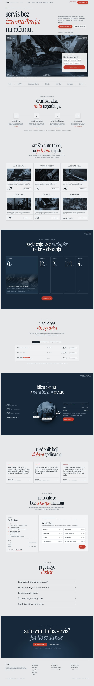

# Autoservis Kovač · koncept web stranice

Novi dizajn stranice Autoservisa Kovač, napravljen po zadanom referentnom videu: svijetla „papirnata” podloga sa zrnom, tamnoplave sekcije sa zaobljenim rubovima, uski serifni naslovi malim slovima, mono oznake u zagradama (`( 12 mj. )`, `/ 01 /`), tanki okviri i kartice u obrisu. Sadržaj (usluge, cijene, načela rada, recenzije, adresa) preuzet je s postojeće demo stranice `autoservis-demo_5.html`. Raspored, tekstovi i kod izrađeni su iznova.

## Usmjereno na zakazivanje termina

- Gumb **Naruči termin** stalno je vidljiv u zaglavlju, a na mobitelu je donja traka **Nazovi / Naruči termin** (skriva se dok je obrazac na ekranu).
- **Brzi termin u heroju**: posjetitelj odabere uslugu i odmah prelazi na drugi korak obrasca s već odabranom uslugom.
- Svaka kartica usluge i svaki redak cjenika ima **Rezerviraj** koji puni obrazac.
- **Obrazac u 3 koraka** (usluga → vozilo i termin → kontakt) s trakom napretka, sažetkom i okvirnom cijenom koja se sama zbraja. Provjerava obavezna polja, ne nudi nedjelju ni prošle dane.
- Uklanjanje prigovora uz CTA: potvrda unutar 2 h, predračun prije rada, 12 mj. garancije, besplatno zamjensko vozilo, otkazivanje do 24 h.
- Oznaka „Sada otvoreno” prema radnom vremenu i istaknut današnji dan u tablici radnog vremena.
- FAQ odgovara na najčešće razloge odgađanja (cijena, trajanje, dijelovi, zamjensko vozilo).

## Tipografija i boje

| | |
|---|---|
| Naslovi | Instrument Serif (uski serif, kurziv za naglaske) |
| Tekst | Inter |
| Oznake i brojke | JetBrains Mono |
| Boje | papir `#e6e8ea`, tinta `#16202a`, tamnoplava `#162839`, čelična `#a9bdd0`, Kovač crvena `#c0392b` samo za pozive na akciju |

Fotografije su s Unsplasha (iz postojeće stranice), u plavo-sivom duotonu.

## Prije objave provjeriti

- **Obrazac je demo**: ništa se ne šalje. Treba ga spojiti na e-mail, Formspree ili sustav za termine (mjesto je označeno u kodu komentarom `DEMO`).
- Postojeća stranica ima proturječne podatke, ovdje je odabrano: telefon **01 / 123-4567**, radno vrijeme **pon–pet 07–19, sub 08–14**, klima servis **od 69 €**. Uklonjena je oznaka „Trešnjevka” jer Heinzelova nije na Trešnjevci. Potvrditi s vlasnikom.
- Recenzije su s postojeće demo stranice (imena skraćena). Za objavu koristiti stvarne recenzije uz suglasnost.
- „Najtraženije” na velikom servisu, 4.8k+ klijenata i ostale brojke preuzete su iz postojećeg sadržaja, nisu provjerene.
