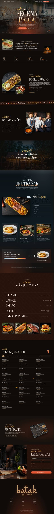

# Batak · koncept web stranice

Koncept službene stranice lanca grill restorana [Batak](https://batak.hr/). Raspored prati zadani referentni dizajn (tamni restoranski landing s velikim serifnim naslovima i kurzivnim „potpisima”): hero preko cijelog ekrana s okruglom značkom, uvod s fotografijama pod kutom, split sekcije, traka s jelima, citat preko fotografije, jelovnici u velikim redovima, rezervacija i podnožje s golemim logom. Sadržaj i fotografije preuzeti su s batak.hr, a kod je izrađen iznova.

## Sadržaj (preuzet s batak.hr, studeni 2026.)

- Slogan „Dobro pečena priča”, 31 restoran u 18 gradova sa stvarnim adresama i telefonima (nove lokacije Bjelovar i Črnomerec označene su kao „Novo”)
- Plata Batak za dvoje, ćevapi od 100 % junetine (5, 7 i 10 komada), punjena vješalica, steakovi, gablec (varivo, paprikaš, punjena paprika, čobanac)
- **Zimska ponuda** iz objave od 25. 11. 2024.: Zimska plata (sarme, češnjovke, buncek sa zeljem, domaći krumpir, senf), sarma na pire krumpiru kao novo sezonsko jelo, buncek sa zeljem i teleća jetrica sa žara
- Batak aplikacija (bodovi, novosti, pogodnosti) s poveznicama na App Store i Google Play
- Podaci tvrtke Filia usluge d.o.o., poveznice na jelovnike, alergene, dostavu, karijere i društvene mreže

## Brand i „začin”

| | |
|---|---|
| Logo | službeni rukopisni „batak” (SVG s batak.hr), inline i u boji `currentColor` |
| Boje (brand) | tamna `#0b0b0b`, bakrena `#c49a6c`, jantar `#f0b551` |
| Boje (dodano) | žar `#e2552d` za CTA i iskre, pečena smeđa `#26110b` umjesto referentne bordo, noćna plava `#0b1216` i mraz `#cfe0ea` samo za zimsku sekciju |
| Fontovi | Instrument Sans (brand font s batak.hr) za tekst, Instrument Serif za naslove i kurzivne potpise |
| Motiv | riblja kost iz opeke Batak interijera kao tekstura pozadine |

Dodatni začini: iskre koje se dižu iz žara u heroju i podnožju, toplo svjetlo koje prati pokazivač, okrugla značka koja se vrti, traka s jelima pod kutom, okrugla slika koja prati pokazivač preko jelovnika.

## Zimska sekcija

Zasebna noćno-plava sekcija s padajućim snijegom („vani zima, unutra žar”):

- **Zimska plata s točkama**: pet točaka na fotografiji (i popis uz nju) opisuje sastojke; radi mišem, dodirom i tipkovnicom
- **Tri kartice** za sarmu, buncek sa zeljem i teleću jetricu, s tekstovima iz objave
- **Zimski termometar**: klizač vanjske temperature (od −15 do +15 °C) predlaže jelo, od Zimske plate na minusu do ćevapa kad je toplo

## Interakcije

Zaglavlje postaje puno nakon heroja i skriva se pri skrolanju prema dolje. Lokacije se filtriraju po regiji i pretražuju (bez obzira na dijakritike). Rezervacija nudi svih 31 restoran i provjerava polja (demo, ništa se ne šalje). Čestice se zaustave kad nisu na ekranu, a `prefers-reduced-motion` gasi animacije. Nema vanjskih JS biblioteka.

## Prije objave provjeriti

- Obrazac za rezervaciju je demo; spojiti na Batakov stvarni sustav rezervacija.
- Fotografije pripadaju Batku; za stvarnu objavu potrebna je njihova suglasnost.
- Cijene namjerno nisu prikazane (stranica vodi na službeni jelovnik).
- Termometar i opisi sastojaka Zimske plate kreativni su tekstovi koje treba odobriti.
