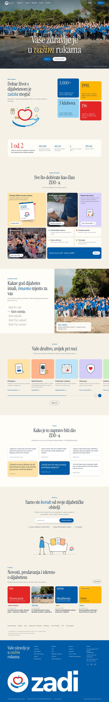

# Zagrebačko dijabetičko društvo · koncept web stranice

Koncept redizajna stranice [zadi.hr](https://www.zadi.hr/) za Zagrebačko dijabetičko društvo (ZDD). Raspored sekcija prati zadani referentni dizajn: hero preko cijelog ekrana s velikim serifnim naslovom, brojke u šarenim pločicama, bento mreža pogodnosti, tabovi s fotografijom, carousel kartica s ilustracijama, zid citata, upisno polje s ilustracijom, novosti, izvori brojki i plavo podnožje s golemim znakom. Sadržaj, ilustracije i kod izrađeni su iznova.

## Sadržaj (preuzet sa zadi.hr, studeni 2026.)

- Moto „Vaše zdravlje je u vašim rukama!”, misija, osnutak 1998., više od 3.000 članova
- Pet klubova: Po-ček (tip 2), Klub roditelja, Klub mladih, Tip 1 odrasli, Tip 1 seniori
- Članarina 15 € / obiteljska 19,90 €, IBAN, uredovno vrijeme, adresa, kontakt
- Časopis ZADI (4 broja godišnje, besplatno za članove), brošura o pravima (s Pravnom klinikom PFZ)
- 13. Obiteljski kamp (196 sudionika, 46 obitelji) i stvarni citati iz „Osvrta sudionika”
- Novosti: akcija „Ulicama grada” 12. 11., webinar o hipoglikemiji, predavanje o kofeinu
- Brojke HZJZ-a i IDF-a s početne stranice, s izvorima u fusnotama

## Brand

| | |
|---|---|
| Logo | jabuka (crvena) iznad dlanova (plavi), uz natpis Zagrebačko / Dijabetičko / Društvo. Koristi se službeni PNG, a za favicon i podnožje vektorska interpretacija |
| Boje | plava `#005ca7` (slova Z D D), nebeska `#2f9fdc` (dlanovi), crvena `#e32525` (jabuka). Dodatno: sunčana `#ffb703`, zelena `#62a329`, krem podloga `#f6f1e7` |
| Fontovi | Instrument Serif (naslovi), Nunito Sans (tekst, srodan Nunitu sa sadašnje stranice) |
| Fotografije | s obiteljskog kampa i objava na zadi.hr. Fotografije klubova Tip 2, Tip 1 odrasli i seniori izrezane su iz stock kolaža lica s naslovnice zadi.hr |

## Interakcije

Zaglavlje je prozirno nad herojem i postaje puno nakon njega, a skriva se pri skrolanju prema dolje. Naslov se otkriva red po red i brojači se odbrojavaju. Klubovi imaju tabove s automatskom izmjenom (strelice na tipkovnici rade). Traka za članove ima indikator napretka i gumbe, a „Kopiraj IBAN” kopira broj računa. Učlanjenje provjerava e-mail (demo, ništa se ne šalje). Ilustracije lagano lebde. `prefers-reduced-motion` je poštovan. Nema vanjskih JS biblioteka.

## Prije objave provjeriti

- Obrazac za učlanjenje, poveznice na PDF-ove (pristupnica, prava i obveze) i „Sve novosti” su rezervirana mjesta.
- Popis partnera je tekstualan; zamijeniti logotipima uz suglasnost partnera.
- Objava citata obitelji uz ime i prezime traži njihovu suglasnost za novu stranicu.
- Fotografije s kampa imaju prava ZDD-a; za objavu djece provjeriti suglasnosti roditelja.
